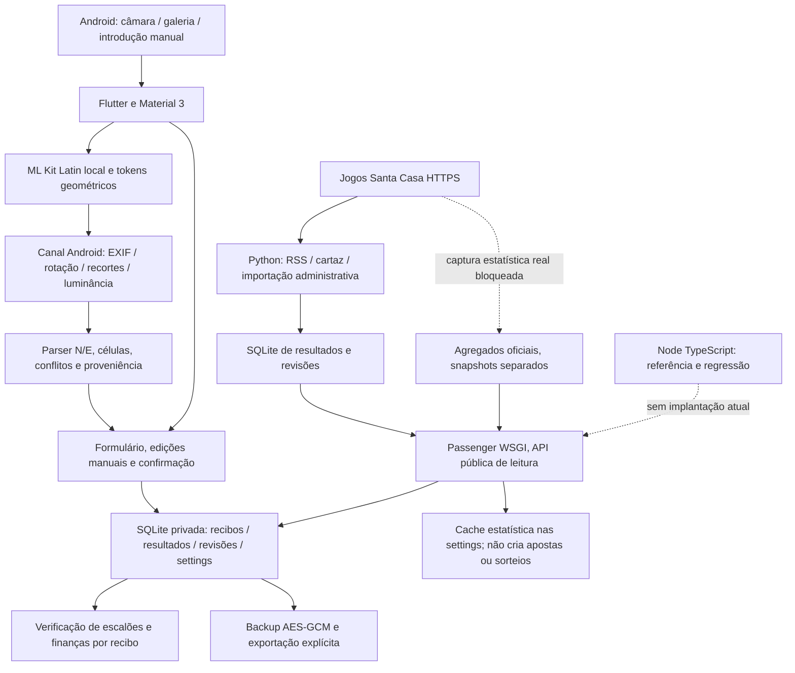
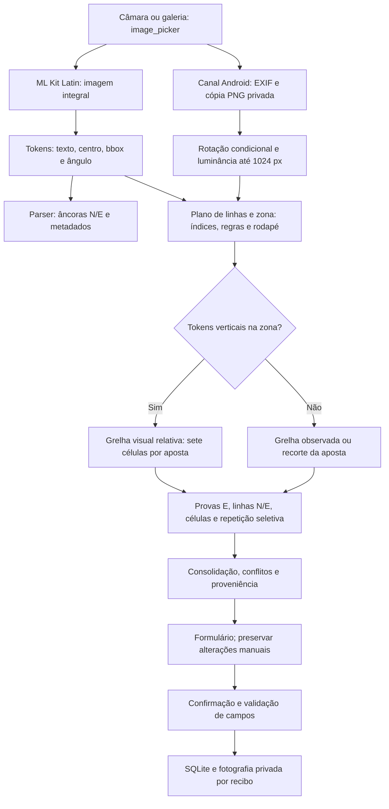

# Auditoria técnica integral do LuckyScan50

Data: **18/10/2026**, Europe/Lisbon. Base efetivamente inspecionada:
`a37ad82d8c7d8c5d5ed37b50506cd07b4c17b8eb`,
`codex/mlkit-ne-line-structure`, com o PR #10 integrado. A auditoria usa código,
reproduções executadas e artefactos identificados; não presume que documentação
ou uma Action verde sejam demonstrações de funcionamento Android.

## A. Resumo executivo

A aplicação tem uma base útil: carteira SQLite transacional, recibos separados
por ID, custo por recibo, 13 escalões, confirmação de OCR e backup autenticado.
O modo manual simples e a expansão de múltiplas calculam corretamente os casos
examinados. Contudo, **não está demonstrada a aceitação real do OCR, nem uma
experiência Android integral sem falhas**. Foram encontradas falhas que os 103
testes Flutter da base não detetavam, incluindo duplicação por confirmação
concorrente, alteração de listas após validação, perda de posições OCR e de
estrelas. Foram corrigidas apenas as causas pequenas com regressões explícitas.

Não foi identificado um P0 nos percursos examinados. Isto não equivale a teste
de intrusão ou certificação. Os principais riscos ainda abertos são confiança
excessiva entre passagens do mesmo ML Kit, memória em imagens grandes, perda da
estrutura original de múltiplas, resíduos de fotografias após restauros e falta
de evidência para estatísticas oficiais, histórico integral e prazos legais.

**A adenda não está integralmente aceite:** o proxy recusa as páginas oficiais;
o snapshot real de 17/10/2026 às 03:00 não foi fornecido nem obtido. Não foram
inventados 62 valores, concursos ou prémios. O novo importador e o cliente
Android funcionam em testes sintéticos e falham de forma explícita se a fonte
não corresponder ao perfil conhecido. A referência continua não verificada.

Não houve deploy, alteração de Cron, recolha contra produção, migração da
carteira, modificação de credenciais/assinatura/identidade Android, merge ou
publicação Google Play. Nenhuma fotografia dos utilizadores foi publicada.

## Inventário e arquitetura confirmados

`main` e a branch Android têm ancestral comum
`836dcabd09fa0d47efe8920aaa2e29ad9690c7fe`; na inspeção, havia **2 commits só em
main e 144 só na branch Android**. A base pedida termina no merge do PR #10.
O modo PDF está numa branch diferente e não está integrado nesta base. A antiga
branch Android e as branches de correção foram examinadas por log/diff; não se
misturaram árvores com funcionalidades diferentes para presumir cobertura.

| Branch remota | SHA observado | Último assunto |
|---|---|---|
| `origin/codex/luckyscan50-android-wallet` | `989463e` | ci: normalize Dart code before strict format check to prevent formatter-bot deadlock |
| `origin/codex/mlkit-ne-line-structure` | `a37ad82` | Android: modo manual visual para apostas simples e múltiplas (#10) |
| `origin/feat/online-pdf-import` | `80b0d1b` | ci(android): compile native PDF renderer in existing Flutter validation workflow |
| `origin/feature/android-manual-bets` | `b8cd159` | test: adapt home navigation to new manual bet selector |
| `origin/fix/android-safearea-brand-ocr-acceptance` | `fea9ac8` | test(ocr): accept trustworthy full-frame corroboration without unnecessary retries |
| `origin/fix/isolated-e-probes-on-current-mlkit` | `7556cca` | fix(ocr): port verified E-probe change to current branch (receipt_cell_geometry_test.dart) |
| `origin/fix/ocr-euromilhoes-regression-issue-3` | `8b3f9fd` | Record verified successful signed APK artifact and access limitations |
| `origin/fix/receipt-metadata-and-small-profile-apk` | `371aaa0` | test: use actual newline escape sequences in physical receipt fixture |
| `origin/fix/receipt-ne-anchored-metadata-20261018` | `24f100e` | test(ocr): E-star rows follow measured variable E offsets across bets |
| `origin/main` | `33ff928` | ci: enable reproducible arm64 ML Kit N/E diagnostic APK builds |



- Produção documentada: Python/Passenger, sem Flask necessário; SQLite e stdlib.
- `backend/` Node continua referência/testes, não deve ser instalado em paralelo
  como substituto da API. Foram reproduzidas divergências e perda concorrente.
- `ticket_readers/ticket_reader.dart` é uma abstração sem integração no scanner;
  não confundir com implementação ativa de todos os formatos.
- Tesseract é protótipo desktop, fora de `pubspec` e do APK. RapidOCR dos anexos
  é outro motor e documento digital; não constitui aceitação do ML Kit Android.
- As 14 dependências diretas de produção têm imports reais. FFI e
  `integration_test` são acrescentados só numa cópia temporária QA. Nenhum
  pacote foi adicionado/atualizado/removido nesta intervenção.

## B. Problemas encontrados e decisões

As fichas dos anexos abaixo contêm, para cada ID, prioridade, ficheiro/função,
causa, evidência, consequência, correção, dificuldade e verificação. As linhas
referem-se à árvore auditada ou à base quando indicado; nomes das funções são
os identificadores estáveis após formatação. P0=crítico; P1=elevado;
P2=moderado; P3=melhoria. Os IDs SEC-04/WAL-06 e alguns achados de CI abordam a
mesma causa em camadas distintas, não representam incidentes adicionais.

| Prioridade | ID / causa | Estado nesta entrega |
|---|---|---|
| P1 | WAL-01, confirmação concorrente duplica recibos/custo | Corrigido nos formulários manual e importado; um modal e uma escrita |
| P1 | WAL-02, listas validadas permaneciam mutáveis | Cópias defensivas imutáveis; mesmo JSON e schema |
| P1 | WAL-03, ID válido curto provoca RangeError | Corrigido, com teste de apresentação de recibo restaurado |
| P1 | OCR-01, plano parcial reduz cinco posições a uma | Corrigido sem apagar posições observadas quando falta limite estrutural |
| P1 | OCR-02/03, índice inferido confirmado e E isolado perdido | Corrigidos, sem completar valores por inferência |
| P1 | OCR-05, votos correlacionados ML Kit | Proposta de evidência por família; precisa corpus Android, não segundo motor artificial |
| P1 | OCR-06, até dois bitmaps32MP antes de ML Kit/UI | Proposta de orçamento global e pré-validação; sem medição RAM em aparelho |
| P1 | STAT-001/002/005, fonte e histórico não comprovados | Importador/cache preparados; aceitação real bloqueada |
| P1 | BE-003, estrela histórica impossível pode entrar por administração | Proposta de validação da carga histórica e auditoria legada, sem invalidar BD instalada |
| P2 | WAL-04/10, overflow e alvos de toque pequenos | Corrigidos; testes320dp, tema escuro e texto1.6 |
| P2 | WAL-05/06/07/08, estrutura múltipla/órfãos/histórico backup/M1lhão autónomo | Propostas e casos de referência, sem migração improvisada |
| P2 | SEC-01/02, validação cliente e overflow cursor SQLite | Corrigidos; datas/prémios/IDs/tipos e resposta400 para cursor excessivo |
| P2 | SEC-05, Node legado aceita resultados inválidos/perde updates | Reprodução offline; manter fora da produção e evitar mecanismo paralelo |
| P2 | OCR-07/08/09/10, passagens redundantes/perspetiva/resíduos/PDF | Plano de intervenção, não anunciados como resolvidos |
| P2 | CI-01/02/03, profile automático/gate normalizado/runtimes mutáveis | Diagnóstico e formatter manuais; gate estrito; Actions Node24 e Ubuntu24 |

### Achados adicionais na nova integração Android de estatísticas

**STAT-ANDROID-01 — P1, corrigido antes da proposta de integração.**
`OfficialStatistics.parse` inicialmente aceitava datas normalizadas e campos
incoerentes que o backend rejeita. Reproduções com data30/02, último concurso
000/ano diferente, data futura e contagem positiva sem última saída/ausência
foram adicionadas às regressões. A fronteira valida62 entradas completas,
intervalos, data/concurso, elegibilidade e percentagens publicadas. A comparação
de arredondamento é racional com BigInt, para não rejeitar uma percentagem
oficial válida por erro binário em valores como2.675→2.68. Dificuldade baixa;
verificação em `app/test/official_statistics_test.dart`.

**STAT-ANDROID-02 — P1, corrigido.** A cache não deve confiar apenas num SHA
que chegou declarado no JSON. Mesmo instante com conteúdo divergente é recusado
por comparação dos indicadores canónicos, preservando o snapshot anterior;
uma captura anterior também não substitui a atual. Teste altera conteúdo
coerente mantendo o SHA declarado e confirma ausência de escrita. A validação
não equivale a verificação criptográfica da resposta contra o HTML ausente.

**STAT-ANDROID-03 — P2, corrigido.** A comparação local é limitada à data UTC
de atualização do snapshot; não inclui sorteios posteriores nem declara a
amostra completa. As frequências locais são calculadas uma vez por build do
ecrã, em vez de percorrer o histórico repetidamente para cada indicador.
Cache inválida não impede tentar ler o histórico local. Teste de indisponibilidade
mantém cache anterior e não escreve na carteira. Não foram medidos tempos
Android deste ecrã. Dificuldade baixa.

## C. Oportunidades de otimização e medidas

| Área | Situação medida | Proposta / resultado | Limite da evidência |
|---|---|---|---|
| Verificação de múltiplas | mediana114602µs no benchmark Dart desktop sintético | 32300µs, -71.8%, conjuntos por concurso; totais idênticos | 20recibos×500linhas, 20avaliações/amostra,7amostras; não é latência Android |
| Persistência de múltiplas | 6N/3E→18linhas; JSON20recibos×500linhas384271bytes | Seleção original+iteração preguiçosa, proposta | Não alterado schema, não alegada poupança medida |
| OCR completo sintético | 1/5/20apostas ainda fazem2/10/40leituras de linha | Selecionar por incerteza e orçamento global | Contagem de chamadas, não precisão/tempo ML Kit real |
| Release histórica0.2.3 ARM64 | APK31860984bytes=31.860984MB=30.385002MiB |4libs e21recursosMLKit; nenhuma dependência dispensável demonstrada | Assinatura debug histórica, não nova entrega privada |
| Release0.2.2→0.2.3 | +131072bytes, +0.4131% | Mesma configuração releaseARM64; crescimento de código | Não atribuído a limpeza de bibliotecas |
| Run39167961097 profile | **ZIP do artefacto21.4MB**, não tamanho APK | Profile agora manual e verificado | APK não descarregado/autenticado; não comparar ZIP com APK |
| Build Profile desta auditoria | falha403 ao obter engine do Flutter | Nenhum APK novo/medição antes-depois | Não substituir dados em falta por comparação debug/release |
| RAM/imagem e abertura | sem dispositivo, não medido | Orçamento de bitmap, cacheWidth, quatrocantos | Estimativa128MB/bitmap32MP não é perfil real de heap |
| Estatísticas | fonte real inacessível | Cache/API independente, sem milhares de draws na APK | Não existem frequências reais incorporadas |

O benchmark reproduzível está em `tools/benchmark_wallet.dart`; os resultados
sintéticos antes/depois em `docs/validation/audit-20261018-metrics.json`.
Não se inclui nenhum histórico de resultados na APK. AAB foi **avaliado como
opção futura** de split por dispositivo, não gerado/publicado: exige política
Google Play, assinatura existente e validação de atualização. AAB não resolve
por si os erros de OCR nem substitui o APK para teste direto.

## D. Funcionalidades completas, parciais e ausentes

| Percurso | Código e testes | Estado real confirmado |
|---|---|---|
| Manual simples/múltipla≤500 | criação, navegação, confirmação, 13 escalões e custoúnico | Widgets e SQLite aprovados; falta ensaio de toque/teclado Android |
| OCR físico N/E multipass | parser, layouts, células, proveniência, proteção edição | Regressões aprovadas; 25 números+10 estrelas nas fotos ainda não demonstrados |
| Quatro cantos/perspetiva | proposta usando Matrix.setPolyToPoly/Canvas já disponíveis | Não implementado; comparar qualidade sem OpenCV primeiro |
| PDF/digital | renderer e parser noutra branch | Ausente desta base; transplantar controladamente, sem merge que apague manual/N/E |
| Carteira/cálculos/backup | transações, AES-GCM, import/export e revisão local | Dados sintéticos preservados; backup não é cópia integral das revisões |
| Recebimento | total manual por recibo | Não é confirmação por prémio/concurso individual |
| Caducidade/reclamação | nenhuma regra oficial recuperada | Não implementada nem validada; ausência de pagamento não implica não recebido |
| Resultados oficiais/RSS/cartaz | importadores e revisões existentes, contratos preservados | Fixtures RSS/cartaz verificadas anteriormente; sem execução em produção nesta tarefa |
| Estatísticas oficiais novas | CLI, snapshots, comparação, endpoint, cache/ecrã Android | Apenas fixtures sintéticas; snapshot17/10 e HTML atual por confirmar |
| Histórico desde2004 | schema/import_rows prontos | Fonte/manifesto/cobertura individuais não obtidos; nunca reconstruído dos agregados |
| Release privada | workflow preserva chave e compara certificado | Sem chave privada local nem novo build release nesta auditoria |

### Proposta para levantamento/reclamações (sem migração nesta entrega)

Separar a **identificação do prémio**, o **pagamento confirmado manualmente** e
a **elegibilidade temporal**. Usar identidade jogo/concurso/participação;
`receivedCents` de um recibo com vários concursos não pode liquidar todos os
prémios individualmente. Estados sem informação devem continuar «desconhecido»
ou «por confirmar», não «por receber». Prazos90/12/60dias só podem entrar como
política versionada com fonte, artigo, vigência, exceções e regras de contagem
confirmados. Não assumir que levantamento e reclamação são o mesmo prazo.
Testes de referência necessários: limites inclusivos, fusoLisboa/ano bissexto,
recebimentos parciais, vários concursos, correção posterior do resultado,
exceção regulamentar, restauro antigo e pagamento já confirmado após prazo.

## E. Plano de intervenção

1. **Primeiro integrar as correções pequenas**, rever os testes vermelhos→verdes
   e confirmar que atualizações mantêm carteira/chave. Não executar limpeza de
   histórico/artefactos durante a auditoria.
2. **Aceitação Android OCR**, em aparelho com duas fotos originais privadas:
   cinco apostas/25 números/10 estrelas, orientação, autofill, edição e gravação
   SQLite. Recolher latência por passagem e RAM; depois calibrar consenso e
   eliminar releituras redundantes sem perder conflitos.
3. **Fonte oficial real**, obter captura permitida de SCEstatisticas e termos;
   confrontar todos62 indicadores/atualização17/10/2026 03:00. Ajustar o perfil
   HTML com fixture real antes de ativar CLI remoto. Não mudar o Cron existente.
4. **Histórico**, investigar SCMotorBusca/arquivo autorizado, manifesto de
   concursos individuais e staging. Importar via Store.import_rows, auditar
   duplicados/lacunas/13 escalões e comparar agregados por períodos elegíveis.
   Igualdade de frequências, isoladamente, não comprova cobertura integral.
5. **Arquitetura em PRs próprios:** seleção original das múltiplas, restauro de
   anexos transacional, backup de revisões e M1lhão autónomo. Cada migração exige
   fixture de versão antiga, round-trip e rollback previamente definidos.
6. **Geometria/UX:** captura ou galeria com4cantos, retificação e transformação
   rastreável; testes de escala/perspetiva. Sem biblioteca nativa pesada até
   haver comparação de qualidade, tempo e APK.
7. **Distribuição:** concluir buildProfile/release com rede/chave adequadas,
   medir APK e ZIP separadamente, confirmar certificado e atualização sem
   desinstalação; rever deduplicação de CI apenas após prova dos gates.
8. **Prazos:** confirmar normas oficiais e só depois introduzir política por
   prémio com pagamento manual, migração e estados desconhecidos preservados.

## F. Evidências de validação e limites

### Comandos e resultados da árvore integrada

- Baseline: `flutter pub get --enforce-lockfile`, `flutter analyze`,
  `flutter test --reporter expanded`: **103 testes aprovados**, análise sem problemas.
- Final integrado: mesmos comandos, mais `dart format lib test
  ../qa/android/integration_test ../qa/android/test_driver ../qa/host` e
  `dart format --output=none --set-exit-if-changed` nos mesmos diretórios:
  **138 testes Flutter aprovados**, análise sem problemas e formatação verificada.
- `python3 -m unittest discover -s api-python -v`: **105 testes aprovados**,
  bases temporárias e fixtures; sem migrações/recolhas de produção.
- `python3 tools/run_flutter_qa.py host`: **7 testes SQLite FFI aprovados**.
- `python3 -m unittest discover -s tools -p test_verify_apk.py -v`: **7 aprovados**.
- Node: instalaçãooffline com cache/sem lock novo, `npm run lint` e `npm test`:
  typecheck aprovado e **10 testes aprovados**. As reproduções de concorrência
  do armazenamento de referência continuam achado em aberto.
- 10 YAML e scripts Bash/Python embutidos analisados estaticamente; isto **não é**
  uma execução nova de Actions. Actions checkout/upload@v6 e github-script@v8
  conferidas nos action.yml/README oficiais das tags que usam Node24.
- `adb devices`: lista vazia. Fotografia real privada não está na árvore do app.
  Testes Android de integração/MLKit/picker/instalação não executados.

### Compilação, artefactos e rede

Build baseline Profile ARM64, cópia exata de `a37ad82`, lock preservado:
`flutter build apk --profile --target-platform android-arm64
--dart-define=LUCKYSCAN_BUILD_SHA=<SHA>`.
Pub get 1.339 s, build+retry 77.742 s; falha em `:app:checkProfileAarMetadata`:
`403 Forbidden` ao obter `io.flutter:flutter_embedding_profile` e
`io.flutter:arm64_v8a_profile` do engine
`035316565ad77281a75305515e4682e6c4c6f7ca` em
`https://storage.googleapis.com/download.flutter.io/`.
Nenhum APKbaseline foi produzido; não se comparou tamanho inexistente.
Chave debug local preservada, não criada/substituída. Release privada não pode
ser assinada localmente sem os secrets existentes; não se gerou chave alternativa.

Run recente consultado: https://github.com/GilPereiraPT/LuckyScan50/actions/runs/39167961097
— success do **profile anterior**, SHA a37ad82, não da auditoria. A release
privada de https://github.com/GilPereiraPT/LuckyScan50/actions/runs/39127946222
é histórica, SHA fb8179e, e não valida alterações desta base mais recente.

`gh` 2.46.0 existe; API api.github.com responde Forbidden antes da autenticação,
logo a validade/scopes do token injetado não podem ser concluídos. As páginas
públicas do GitHub funcionam, mas logs/download/abertura de PR exigem acesso
autorizado adicional. Foi guardado rascunho de rede limitado a api.github.com,
www.jogossantacasa.pt e storage.googleapis.com, preservando os presets; precisa
revisão/gravação/publicação nas definições do ambiente e não foi aplicado à
sessão. Não se contornou a política nem se extraíram credenciais do proxy.

A tentativa às três páginasSC falhou no CONNECT403. Isto não prova que o site
esteja indisponível ou que rejeite reutilização; **condições de reutilização e
regulamentos continuam por confirmar**. CLIstats não foi acrescentado ao Cron.

### Entrega e separação de alterações

Correções pequenas/auditoria e integração estatística são propostas em branches
separadas. O relatório acompanha a primeira; a segunda depende da primeira.
A criação efetiva de PRs e os SHAs finais serão registados em
`docs/development-audit.md` depois de publicar as branches. Uma ligação compare
não deve ser apresentada como PR aberto. Não se declara a adenda concluída
antes de validar a captura real e a apresentação com esses dados.

## Anexos: fichas técnicas completas

As análises seguintes aprofundam os mesmos achados, com localizações,
reproduções, dificuldades, limites e testes por componente. Os números de testes
dos anexos são subconjuntos/instantes de execução; o total integrado é o da secção F.
## Auditoria do OCR, imagens e PDF

Base inspecionada: `a37ad82` de `origin/codex/mlkit-ne-line-structure`, worktree `/workspace/LuckyScan50-audit`, 18/10/2026. Os números de linha abaixo referem-se à árvore auditada com as pequenas correções desta auditoria, salvo indicação expressa «base». Nenhum resultado abaixo demonstra reconhecimento real no Android.

### Fluxo confirmado no código



`receipt_scanner.dart` reutiliza uma instância ML Kit durante a sessão e fecha-a no `finally`; as operações de bitmap são executadas num executor nativo, fora da UI. Os PNG de recorte são apagados depois da leitura e as sessões são destruídas no fim normal da sessão. O relatório usa uma allowlist sem fotografias/caminhos e informa explicitamente que o texto reconhecido pode conter identificadores pessoais. Não encontrei envio das fotografias ao backend nem Tesseract/RapidOCR incorporado neste percurso Android. `tools/compare_receipt_regions.py` é um protótipo desktop separado, com scoring que não alimenta os valores esperados ao reconhecedor.

### Achados

#### OCR-01 — P1 — Contagem geométrica parcial apaga posições conhecidas [corrigido de forma conservadora]

- **Local:** `app/lib/domain/receipt_parser.dart:614`, `withBetLayout`; chamadas em `receipt_multipass.dart:115`/`:182` e `receipt_cell_recovery.dart:26`.
- **Causa/evidência:** na base, `withBetLayout(first, 1)` sobre uma leitura com cabeçalho `5 AP SIMPLES` devolvia `expectedLines=1`, uma só posição e uma única chave completa. O repro Dart registou `before=5/5 after=1/1`. O código filtrava todas as apostas cujo índice excedesse a contagem do plano e substituía a contagem textual mesmo quando não havia rodapé delimitado.
- **Consequência:** uma fotografia com apenas a primeira âncora sobrevivente podia mostrar «1/1», apagando quatro posições pendentes. É uma causa comprovada no parser para o sintoma «só uma de cinco»; não prova que seja a única causa das fotografias reais.
- **Correção:** preservar a maior contagem/posição já observada enquanto a zona não tiver uma regra inferior confirmada. Com `footerRule` disponível, manter a política existente de priorizar a estrutura visual e apresentar a divergência. Não criar recortes sem âncoras nem inventar valores. Foram adicionados testes dos dois casos.
- **Dificuldade:** baixa; implementado. **Teste:** `receipt_audit_regression_test.dart` (contagem cinco→um e índice posterior); todos os testes existentes de contagem dinâmica continuaram a passar, incluindo o caso em que zona delimitada com duas apostas contraria cabeçalho cinco.
- **Limite:** uma regra inferior incorretamente detetada ainda pode fechar a zona cedo. A correção não transforma deteção visual em prova de quantidade: o aviso continua necessário.

#### OCR-02 — P1 — Fallback textual aceita índice inferido como confirmado [corrigido]

- **Local:** `receipt_parser.dart:557–566`, `_parseBets`; `receipt_multipass.dart:103`, `_cropCandidate`.
- **Causa/evidência:** `parseReceiptObservations(text: 'N 06 20 29 32 48\nE 04 06')` produzia uma aposta completa, índice 1 e nenhuma incerteza. Tokens agrupados contendo `N` mais toda a linha seguiam este fallback, contornando a proteção do parser de elementos separados.
- **Consequência:** uma aposta sem identificador legível podia ficar associada à posição errada sem aviso, sobretudo quando faltava outra aposta antes dela.
- **Correção:** conservar os valores observados, mas marcar índice pendente. Apenas um recorte cujo plano já tem identificador impresso verificado pode retirar esse motivo específico de incerteza; as outras validações permanecem.
- **Dificuldade:** baixa; implementado. **Teste:** texto sem tokens e tokens agrupados ficam pendentes; testes multipass existentes preservam aceitação de recortes legitimamente associados.

#### OCR-03 — P1 — `E` isolado seguido da linha numérica perde as estrelas [corrigido]

- **Local:** `receipt_parser.dart:577–587`, `_parseBets`; teste anterior `receipt_ne_lines_test.dart:26–39`.
- **Causa/evidência:** ler uma linha `E` vazia definia `hasStars=true`; a linha seguinte `04 06` já não era aceite como números nem estrelas e originava `flush`. Repro: `stars=[]`, aposta incompleta. O teste antigo só exigia `stars.length <= 2`, o que deixava a falha passar.
- **Consequência:** estrelas efetivamente presentes no texto OCR desapareciam no fallback, enquanto o teste denominado «N seguido de E isolado» continuava verde.
- **Correção:** estado explícito que autoriza a próxima linha estritamente numérica após `E`, sem atravessar uma nova âncora N ou o rodapé. Nenhum teste existente foi enfraquecido.
- **Dificuldade:** baixa; implementado. **Teste:** duas apostas completas com `E` isolado; ausência de estrelas antes do N seguinte fica pendente; algarismos após TOTAL não são utilizados.

#### OCR-04 — P2 — Fotografia invertida 180° sem palavras verticais não tentava rotação [corrigido; falta prova nativa]

- **Local:** `receipt_scanner.dart:53–70`, `:122`; anteriormente condição `uprightBetRowCount == 0 && any(verticalReceiptToken)`.
- **Causa/evidência:** uma âncora N com ângulo 180° tinha zero linhas consideradas direitas, mas `verticalReceiptToken=false`. A pesquisa de rotação não começava, embora `preferredReceiptTurns` indicasse 180° como primeira tentativa.
- **Consequência:** orientação suportada pelo backend ficava inacessível num caso legítimo.
- **Correção:** também iniciar pesquisa quando há uma âncora numerada N com ângulo que demonstra orientação invertida/lateral e nenhuma linha direita. Não executar rotações para uma imagem vazia sem evidência.
- **Dificuldade:** baixa; implementado. **Teste:** helper usado diretamente pelo scanner; 180° pede rotação, N direito e frame vazio não a pedem. **Limite:** o teste não executa os pixels Kotlin nem ML Kit.

#### OCR-05 — P1 — Passagens do mesmo ML Kit promovidas a «confirmação» [proposta; sem alteração do algoritmo]

- **Local:** `receipt_cell_consensus.dart:71–76`, `receipt_cell_recovery.dart:165–177`, `:215–249`.
- **Causa/evidência:** um valor é confirmado se houver dois `pass` distintos, independentemente de motor, modelo, fotografia e família de transformação. Duas observações `O6`→`06`, ambas `requiresConfirmation=true`, com IDs `cell@1x` e `cell@2x-contrast` produzem `numbers=[6]` aceite. O teste existente confirma intencionalmente «different pass», não independência estatística. Todas estas observações vêm da mesma instância ML Kit.
- **Consequência:** o mesmo erro sistemático pode repetir-se no original, linha, célula e contraste, ganhando confiança indevida. Não existe demonstração de que estas repetições sejam independentes. A confirmação final geral do utilizador continua obrigatória; o problema é a promoção interna do valor para aceite.
- **Correção recomendada:** modelar `engine`, versão, imagem/sessão e família de observação; chamar-lhe concordância de passagens, nunca confirmação independente. Manter valores corrigidos ou glifos truncados assinalados e sujeitos a confirmação visual explícita até existir calibração Android por célula. Medir precisão/falsos positivos antes de alterar limiares; não acrescentar Tesseract ao APK só para produzir um segundo voto.
- **Dificuldade:** média/alta; alteração de política exige corpus real. **Teste:** mesma leitura errada em 1x/2x/contraste não deve elevar confiança automaticamente; grupos incompatíveis devem continuar pendentes, mesmo com maioria numérica de uma variante.

#### OCR-06 — P1 — Memória sem orçamento global e verificação de tamanho posterior ao primeiro ML Kit [proposta]

- **Local:** `receipt_scanner.dart:98–109`; `MainActivity.kt:68–103`, `:127–147`, `:167–199`; preview em `main.dart` (Image.file).
- **Causa/evidência:** o primeiro `processImage` ocorre antes de `prepare`, onde só então se aplica o limite de 32 milhões de pixels. `prepare` descodifica a resolução integral; EXIF com rotação/flip pode coexistir com o bitmap original. A 32 MP e ARGB_8888 são aproximadamente 128 MB por bitmap, 256 MB para dois, antes de ML Kit, engine/UI e buffers PNG. `rotate` volta a descodificar o PNG integral. Um recorte pode coexistir com bitmap descodificado, rodado, opaco, contraste e ampliado; o limite de 16 MP só verifica a saída geométrica principal, não a soma destes buffers. Há captura de OutOfMemoryError e fallback, mas não prevenção global.
- **Consequência:** picos elevados de RAM, falhas de preparação e perdas do OCR multipass em dispositivos com menos memória; 32 MP não é um orçamento adaptado ao dispositivo. Não medi RAM real num Android.
- **Correção recomendada:** ler cabeçalho/dimensões antes do primeiro ML Kit, definir orçamento total, trabalhar numa imagem retificada dimensionada por altura real dos glifos e usar a original apenas em regiões que precisem de detalhe. Evitar rotações PNG integrais repetidas, limitar buffers em simultâneo e ajustar preview por `cacheWidth`. Guardar transformações para mapear coordenadas à original.
- **Dificuldade:** média/alta; requer perfil Android. **Teste:** 12/32/48/120 MP, EXIF 1–8, heap limitado, imagem inválida, cancelamento e repetição. Medir pico RSS/heap, duração e completude, sem atribuir métricas desktop ao Android.

#### OCR-07 — P2 — OCR de linhas sempre executado mesmo quando todas as células já são conhecidas [medido com simulação]

- **Local:** `receipt_cell_recovery.dart:133–179`, antes da decisão de saltar células em `:194–201`.
- **Causa/evidência:** as duas linhas de cada aposta são reconhecidas incondicionalmente quando a grelha existe. Repro com geometria simulada, todas as observações originais válidas e callback vazio: 1 aposta→2 pedidos OCR e 7 células saltadas; 5→10 pedidos e 35 saltadas; 20→40 pedidos e 140 saltadas. O orçamento máximo do método é 20 passagens por aposta (até 400), além de OCR inicial e até três orientações. Estas contagens são do controlo de fluxo, não tempos do motor real.
- **Consequência:** recortes/IO/ML Kit adicionais sobre talões já completos; latência/bateria aumentam linearmente. Sem timeout/cancelamento e sem progresso por célula, um talão difícil pode manter apenas um indicador genérico durante muitas passagens.
- **Correção recomendada:** calcular primeiro incertezas/conflitos e pedir linhas só para grupos incompletos ou contaminados; manter revalidação amostral como modo de diagnóstico separado. Introduzir cancelamento entre passagens, orçamento temporal global e progresso por etapa; conservar resultado parcial ao atingir limite.
- **Dificuldade:** média. **Teste:** no caminho normal completo, zero OCR adicional; no contaminado, releituras continuam obrigatórias. Comparar precisão/latência por aposta em Android antes/depois e garantir que o ganho não elimina deteção de conflitos.

#### OCR-08 — P2 — Geometria não corrige perspetiva e os recortes de linha perdem a inclinação [proposta]

- **Local:** `receipt_cells.dart:53–59`, `:315–349`, `:397–406`; `receipt_cell_recovery.dart:146–159`; `MainActivity.kt:170–180`.
- **Causa/evidência:** grelha visual agrupa centros X num sistema global, usa espaçamento mediano e extrapola as cinco colunas a partir da última; não há quadrilátero/homografia. As coordenadas são relativas aos glifos e dimensão da imagem, não um conjunto fixo de pixels — existe adaptação de escala, mas não perspetiva. A grelha visual cria `BetCrop` sem `deskewDegrees`; o recorte de linha obtém uma caixa que une células inclinadas e também não transporta o ângulo. Para comprimento 500 px e 10°, a diferença geométrica entre extremos é cerca de 88 px; a caixa de união pode incluir a linha vizinha apesar de os recortes individuais estarem centrados corretamente.
- **Consequência:** mais rejeições/recortes vazios em fotos inclinadas ou com convergência das colunas; possibilidade de misturar glifos de N/E na caixa de linha. Não executei uma fotografia que demonstre este caso real.
- **Correção recomendada:** captura/galeria com quatro cantos ajustáveis e projeção para o plano do talão antes da segmentação; conservar transformação e recortes originais com margens. Usar `Matrix.setPolyToPoly`/Canvas Android ou equivalente já disponível, comparando qualidade/tempo antes de introduzir OpenCV. Até lá, transportar a inclinação para as tiras N/E e testar recortes renderizados.
- **Dificuldade:** alta para UX+retificação; média para tiras. **Teste:** quadriláteros sintéticos com referência, 0/5/10/15°, ±perspetiva e resoluções diferentes; provas reais de 1/2/5/12/20 apostas e separação N/E curta.

#### OCR-09 — P2 — Limpeza incompleta após crash e exclusão de dados [proposta de privacidade]

- **Local:** `MainActivity.kt:75`, `:132`, `:203–209`; exportação `main.dart` (relatório `LuckyScan50-OCR-*.json`); eliminação `main.dart:715–730`.
- **Causa/evidência:** sessões são apagadas em `dispose`/`onDestroy`, mas o sistema pode terminar o processo sem executar `onDestroy`. Não há limpeza por idade no arranque para `receipt-pass-*`. JSON OCR partilhados ficam no diretório temporário; a ação «eliminar todos ... imagens» só apaga pasta receipts e os nomes fixos backup/csv. Pode permanecer texto OCR com identificadores e cópias privadas em cache. Não há prova de exposição externa automática; os ficheiros ficam no sandbox/cache.
- **Consequência:** dados sensíveis residuais e consumo de disco após interrupção ou ação de eliminação integral.
- **Correção recomendada:** sessões com prefixo seguro e prazo de retenção, limpeza no arranque e na ação de apagar dados, evitando diretórios em uso; apagar relatórios após partilha quando compatível com a API de partilha ou em limpeza posterior. Não tocar originais da galeria.
- **Dificuldade:** baixa/média. **Teste:** simular processo interrompido, exportação cancelada/concluída e apagar dados; verificar ausência dos ficheiros geridos e preservação da fotografia original.

#### OCR-10 — P2 — PDF/digital documentado, mas ausente desta branch [funcionalidade incompleta]

- **Local:** `main.dart` fluxo AddReceipt mostra apenas câmara/galeria; `receipt_scanner.dart:72`; ausência de `online_pdf_receipt.dart`/`PdfRenderer` na base. `docs/OCR_MLKIT_NE_LINES.md:16` afirma via distinta PDF, mas essa via está noutra branch.
- **Evidência:** `origin/feat/online-pdf-import` (`80b0d1b`) contém `PdfRenderer` Android nativo, validação de assinatura `%PDF-`, 25 MB, até20 páginas e página escolhida, e `parseOnlinePdfReceipt`; merge-base `989463e`. A diff integral contra a base elimina o modo manual e parte dos métodos N/E recentes: não integrar a branch inteira por sobreposição/cherry-pick cego.
- **Limite adicional da branch PDF:** parser de tabela varre padrões de sete valores em qualquer linha, escolhe o candidato com maior quantidade entre geometrias/textos sem conflito, não delimita estritamente a coluna APOSTAS e não trata os algarismos concatenados/sem zeros da captura real (`716374546 + 19`, `1620222628+712`, `28162835+49`). Esta captura digital é RapidOCR desktop, não ML Kit. Uma linha digital inválida pode ser omitida e as seguintes renumeradas; falta identidade espacial por linha. `PdfRenderer` rasteriza PDFs digitais e fotografados; não extrai a camada de texto.
- **Correção recomendada:** PR independente que transplante apenas renderer/contrato e UI necessários para a branch atual; deteção explícita do layout, limites de coluna/linha, metadados e concursos independentes, comparação de alternativas sem escolher apenas maior contagem. Renderizar páginas de forma limitada e libertar PNGs; para digital, avaliar extração de texto autorizada sem adicionar biblioteca grande. Nunca completar divisões ambíguas com apostas esperadas.
- **Dificuldade:** média/alta. **Teste:** PDF digital e PDF de fotografia, várias páginas, inválido/protegido, códigos M1lhão, datas de compra/sorteio distintas, linhas parciais e concursos dos dois jogos; ensaio Android e teste das regressões manuais atuais antes de integrar.

### Cobertura e limites

- Testes de `receipt_parser`, geometria e consenso operam sobre texto/tokens/raster sintéticos. A fixture `receipt_1792267583612_geometry.json` deriva de um diagnóstico real, remove identificadores e usa altura de fronteira de teste: não contém os pixels da fotografia.
- `receipt_visual_recovery_test.dart:95–130` devolve no callback valores conhecidos pelo índice/posição. É útil para verificar associação, orçamentos e estados; não demonstra que ML Kit consegue ler estes recortes. O nome «five complete bets» precisa de ser interpretado nesse âmbito.
- O teste Android `qa/android/integration_test/receipt_real_images_test.dart` usa fotografias privadas reais em duas orientações, compara 25 números+10 estrelas e leva o resultado real ao formulário. Falha explicitamente sem Android/fotografias; não há skip silencioso. A aquisição/picker é substituída no teste do formulário, e não há neste teste gravação final SQLite. Faltam variantes de escala/perspetiva, EXIF1–8, consumo de memória, caminhos digital/PDF e persistência de um scan real.
- `/workspace/.tools/android-sdk/platform-tools/adb devices -l` devolveu lista vazia. `app/assets/private_receipts/` só contém README. Não executei aceitação Android nem medi latência/precisão/memória do ML Kit ou do APK num aparelho.
- Os anexos RapidOCR recentes foram lidos como evidência externa de outro motor e formato; não foram copiados para o código, assets nem artifacts públicos. Concordância de original/contraste/nitidez não demonstra independência das leituras.

### Validação executada e pequenas correções

- Antes: `/tmp/luckyscan-ocr-audit-repro.dart` reproduziu contagem5→1, índice inferido completo, E isolado sem estrelas, correção corroborada por duas variantes do mesmo motor e ausência de trigger180°.
- Depois: o mesmo repro mostrou contagem5→5 com quatro posições pendentes, N sem índice incompleto e E isolado `[4,6]`; o problema de confiança correlacionada permanece documentado, sem alterações ao consenso.
- `dart format lib/data/receipt_scanner.dart lib/domain/receipt_parser.dart lib/domain/receipt_multipass.dart lib/domain/receipt_cell_recovery.dart test/receipt_audit_regression_test.dart` executado (somente ficheiros atribuídos à auditoria OCR).
- `flutter test --no-pub test/receipt_audit_regression_test.dart test/receipt_multipass_test.dart test/receipt_ne_lines_test.dart test/receipt_dynamic_layout_test.dart --reporter expanded`: **43 testes aprovados**, incluindo **7 novos**, log `/tmp/luckyscan-audit-ocr-tests.log`. Não foram alteradas expectativas dos testes existentes. O root executa a análise e bateria integral após integrar os restantes subtrabalhos.
- Simulação `/tmp/luckyscan-ocr-pass-count.dart`: 2/10/40 chamadas de linha para1/5/20 apostas completas; só prova processamento redundante no controlo de fluxo, não quantifica custo Android.
- Alterações OCR desta auditoria: `app/lib/data/receipt_scanner.dart`, `app/lib/domain/receipt_parser.dart`, `app/lib/domain/receipt_multipass.dart`, `app/lib/domain/receipt_cell_recovery.dart`, `app/test/receipt_audit_regression_test.dart`. Sem dependências novas, sem imagem publicada e sem backend modificado por este subtrabalho.

### Plano proposto para quatro cantos / performance / prova real

1. Prova pequena com quadrilátero manual sobre imagem da câmara/galeria, transformação Android existente, resolução limitada pela legibilidade do glifo; registar matriz original→trabalho e inversa. Preservar original e não gravar pixels no relatório.
2. Corpus privado anotado com layouts1/2/5/12/20 e dois dígitos, luminosidade, rotação e perspetiva; incluir falhas/negativos e comprovativo online separado.
3. Comparar original atual, retificado e retificado+passagens seletivas: exatidão5+2 por aposta, recall dos identificadores/E, falsos valores aceites, p50/p95 tempo, memória máxima e número de chamadas. Critério explícito para não promover concordância ML Kit a prova independente.
4. Só depois integrar o editor de cantos e cancelamento/progresso na UI. Manter preenchimento conservador, formulário editável, confirmação por aposta em conflitos e regras atuais de preservação das edições.
5. Tesseract mantém-se desktop/regiões problemáticas, com relatório comparativo real; OpenCV ou novo motor Android apenas mediante benefício medido que justifique tamanho e manutenção.
# Auditoria da carteira, modo manual e cópias de segurança

Base inspecionada: branch de auditoria baseada em `a37ad82` (PR #10). Ficheiros principais: `app/lib/manual_bets_page.dart`, `app/lib/domain/wallet.dart`, `app/lib/domain/prize_calculator.dart`, `app/lib/data/wallet_store.dart`, `app/lib/data/backup.dart` e percursos da carteira em `app/lib/main.dart`. Nenhum dado de produção ou credencial foi lido ou alterado. Não houve migração de esquema.

## Resultados confirmados

- Os 13 escalões no domínio correspondem à tabela de acertos do Euromilhões. A multiplicidade é tratada por combinação; a despesa é somada uma vez por recibo.
- Uma seleção sintética com 6 números e 3 estrelas produz 18 combinações distintas. Face a uma chave com os cinco primeiros números e as duas primeiras estrelas, resulta em 1×5+2, 2×5+1, 5×4+2 e 10×4+1. Com valores sintéticos 10000/1000/200/100 cêntimos, são 14000 cêntimos identificados; o gasto único continua 660 cêntimos.
- Resultados repetidos no argumento de verificação e na cache SQLite não multiplicam prémios do mesmo concurso.
- Os identificadores são separados por jogo: `009/2026` Euromilhões não é `009/2026` M1lhão.
- `null` em prémios continua desconhecido; não se converte em zero nem se marca concluído.
- Recibos distintos com seleções iguais são preservados; não é correto deduplicar apenas pelos números da aposta.
- SQLite v1 mantém transações para recibo+histórico, resultados+lastSync, restauro, eliminação e limpeza. Testes com falhas injetadas comprovaram rollback.
- Backup usa AES-GCM256, salt aleatório de 16 bytes e PBKDF2-HMAC-SHA256 com 210000 iterações. Palavra-passe errada ou corrupção são rejeitadas; anexos em falta impedem backup incompleto silencioso.
- A data manual é validada por round-trip ISO; datas como 2026-02-30 não passam. Não há inferência de data de sorteio a partir de publicação RSS neste módulo.

## Achados

### WAL-01 — P1 — Submissões concorrentes criam confirmações e recibos duplicados

**Localização:** `manual_bets_page.dart`, `_ManualBetPageState.save`; `main.dart`, `_AddReceiptState.save`.
**Causa:** no modo manual `saving` só era ativado depois de aguardar o diálogo; no formulário importado `save` não tinha bloqueio próprio. Duas chamadas anteriores à montagem do modal criavam duas submissões, cada uma com ID novo.
**Evidência:** teste widget abre exatamente dois diálogos `Confirmar registo` no código anterior; teste do formulário importado também encontra dois `AlertDialog`. Logs `/tmp/luckyscan-wallet-before.log` e `/tmp/luckyscan-wallet-add-before.log`.
**Impacto:** duplicação indevida de recibos, gastos e prémios identificados.
**Correção:** bloquear desde a entrada da operação, incluindo confirmação; libertar no `finally`; desativar edição enquanto existe operação em curso. Implementado no modo manual; agente principal corrigiu também o formulário importado com `saving` independente de `busy` (OCR).
**Dificuldade:** baixa.
**Verificação:** duas invocações antes de `pump`, um único modal, uma única persistência de 220 cêntimos, retorno à carteira. O teste do formulário importado estava vermelho antes da correção do agente principal e passou depois.

### WAL-02 — P1 — Coleções validadas permaneciam mutáveis

**Localização:** `wallet.dart`, construtores `BetLine` e `Receipt`.
**Causa:** `final List` preservava a referência à lista fornecida. Depois do construtor, chamadores podiam trocar números, esvaziar linhas ou adicionar IDs/códigos duplicados sem nova validação.
**Evidência:** regressões demonstraram que alterar `numbers[0]` alterava a chave guardada e `lines.clear()` esvaziava um recibo já validado. Duplicar drawIds/códigos após validação permitiria multiplicar prémios.
**Impacto:** invariantes do domínio não eram estáveis entre validação e persistência/verificação.
**Correção:** cópias defensivas `List.unmodifiable` em todos os campos de coleção dos dois modelos; estrutura JSON preservada. Implementada sem mudança de esquema ou formato de backup.
**Dificuldade:** baixa.
**Verificação:** mutação das listas originais não altera modelos; mutação direta é rejeitada; M1lhão permanece contado uma vez; testes existentes de backup e persistência passaram.

### WAL-03 — P1 — Identificador curto provoca erro ao mostrar recibo

**Localização:** `main.dart`, `ticketTile`.
**Causa:** `receipt.id.substring(0,6)` assumia mínimo de seis caracteres, mas `Receipt` aceita IDs de 1 a 100 caracteres.
**Evidência:** IDs curtos como `one` são válidos e já usados pelos fixtures; um recibo sem código com tal ID causa `RangeError` no resumo da carteira.
**Impacto:** recibos legítimos restaurados podem impedir a apresentação da carteira.
**Correção:** limitar substring ao comprimento real; agente principal assumiu implementação e testes.
**Dificuldade:** baixa.
**Verificação:** abrir carteira com recibo sem código e ID de três caracteres.

### WAL-04 — P2 — Overflow do modo manual em Android pequeno

**Localização:** `manual_bets_page.dart`, quantidade e cabeçalho Simples/Múltipla.
**Causa:** duas linhas `Row` tinham larguras mínimas superiores ao espaço da página.
**Evidência:** widget test 320×640 dp reproduziu overflow de 99 px na quantidade e 26 px no cabeçalho. Log `/tmp/luckyscan-wallet-before.log`.
**Impacto:** elementos cortados e escolha de modo pouco utilizável.
**Correção:** Wrap para controlos e total; orientação adaptativa do seletor de modo. Implementada preservando Material 3 e identidade visual.
**Dificuldade:** baixa.
**Verificação:** 320 dp normal; 320 dp com tema escuro e escala de texto 1.6; navegação entre rascunhos sem perda dos seus números/estrelas. Estes testes passaram.

### WAL-05 — P2 — Expansão perde estrutura original da múltipla

**Localização:** `manual_bets_page.dart`, `expandManualSelections` e criação de `Receipt`; `wallet.dart`, `Receipt.toJson`.
**Causa:** o modelo só persiste as chaves simples expandidas. Não guarda conjuntos originais nem agrupamento de uma múltipla.
**Evidência:** seleção 6N/3E é serializada como 18 `BetLine`, sem metadados que a distingam de 18 apostas simples independentes. Não existe edição posterior da seleção no detalhe do recibo.
**Impacto:** verificação/despesa são corretas, mas representação, edição e contagem da aposta original são incompletas. Há limite funcional de 500 combinações por registo.
**Proposta:** adicionar representação de seleção original com schema de payload versionado e defaults compatíveis; calcular combinações por iterador na verificação. Guardar custo no recibo, não por combinação. Manter linhas legadas e cobertura de todos os escalões. Definir limite por complexidade de verificação, não inventar limite oficial de aposta. Exige proposta e teste de migração; não implementado nesta correção.
**Dificuldade:** média/alta.
**Verificação:** round-trip preserva 6N/3E como uma seleção; verificação idêntica às 18 combinações; versões antigas abrem; custo contado uma vez; edição conserva agrupamento.

### WAL-06 — P2 — Restauros repetidos deixam imagens órfãs

**Localização:** `backup.dart`, `decrypt` extração de imagens; `wallet_store.dart`, `restore`; `main.dart`, `restore`.
**Causa:** imagens são extraídas para nomes sempre novos antes de o restauro SQLite ignorar IDs existentes. Ficheiros e merge não partilham transação ou fase de confirmação.
**Evidência:** duas descodificações do mesmo backup sintético produziram dois ficheiros de imagem, mesmo ID de recibo e caminhos diferentes. A base preserva apenas o caminho original. Resultado `/tmp/luckyscan-wallet-backup-repeat.json`: `sameReceiptId:true`, `sameImagePath:false`, `extractedImageFilesAfterTwoRestores:2`, `imagesKeptWhenStoreMergesById:1`.
**Impacto:** crescimento de armazenamento privado; falha na gravação pode deixar ficheiros sem recibo associado.
**Proposta:** extrair em diretório temporário; obter IDs realmente inseridos; promover apenas anexos necessários; limpar rejeitados e desfazer ficheiros criados em caso de erro. Preservar anexos existentes; não apagar por ID de outra versão. Não implementado, para coordenar camada de ficheiros e banco sem perda.
**Dificuldade:** média.
**Verificação:** restauro repetido mantém contagem de ficheiros; falha injetada após extração não deixa resíduos; rollback preserva imagens atuais.

### WAL-07 — P2 — Backup não preserva histórico completo da carteira

**Localização:** `backup.dart`, payload `receipts/images`; `wallet_store.dart`, tabela `history` e `restore`.
**Causa:** exporta apenas snapshot de recibos e imagens, não revisões, resultados ou preferências. `restore` também não cria uma revisão inicial para recibos novos.
**Evidência:** payload versão2 tem exclusivamente `receipts` e `images`; API de backup recebe `List<Receipt>` e não tem acesso ao histórico. Teste SQLite mostra que restauros não duplicam o histórico existente, mas recibos novos restaurados não ganham revisão.
**Impacto:** snapshot financeiro atual é recuperado; auditoria cronológica de correções/recebimentos não migra entre dispositivos. Não classificar cópia atual como backup integral da base.
**Proposta:** definir explicitamente âmbito da cópia e versão nova do envelope, com revisões e autoria/origem de restauro, validação e compatibilidade v1/v2. Cache pública pode continuar fora da cópia se voltar a descarregar sem alterar recibos. Não implementado.
**Dificuldade:** média.
**Verificação:** duas alterações/recebimentos mantêm sequência após restauro; replay não duplica; cópias antigas continuam válidas.

### WAL-08 — P2 — Recibo exclusivamente M1lhão não é representável

**Localização:** `wallet.dart`, construtor `Receipt` exige `lines` e `drawIds` de Euromilhões não vazios; formulário em `main.dart`.
**Causa:** M1lhão é modelo complementar ao recibo Euromilhões. O cálculo M1lhão funciona para recibos mistos; a estrutura não permite guardar apenas código(s)/concurso M1lhão.
**Evidência:** Receipt com listas Euromilhões vazias e código/concurso M1lhão válidos lança `FormatException`. O OCR já apresenta mensagem de boletim M1lhão, podendo sugerir que esse percurso é autónomo.
**Impacto:** documento M1lhão separado requer associação a um recibo Euromilhões; não se deve inventar chave para permitir gravar.
**Proposta:** explicitar associação atual na interface; se requisito autónomo for confirmado, modelar jogos opcionais com regra «pelo menos uma participação válida», incluindo detalhe/listagem/exportação e compatibilidade de cópias. Não alterar invariantes isoladamente.
**Dificuldade:** média.
**Verificação:** recibo M1lhão autónomo real e misto; zero linhas Euromilhões nunca deve gerar aposta fictícia; custo único.

### WAL-09 — P2 — Validação de seleção e limite dependia demasiado da UI

**Localização:** `manual_bets_page.dart`, `ManualSelection.valid`, `expandManualSelections`.
**Causa:** valid verificava quantidades, não intervalos; expand aceitava coleção vazia e só rejeitava >500 depois de gerar 501 objetos.
**Evidência:** seleção cardinalmente correta com 0/51 ou estrela13 era marcada válida, embora BetLine mais tarde rejeitasse; lista vazia resultava vazia.
**Impacto:** estados contraditórios em futuros consumidores/testes e validação tardia. A UI atual só oferece números legais, pelo que não há evidência de recibo inválido persistido por este percurso.
**Correção:** intervalos explícitos; rejeição de lista vazia; validar total antes de expandir. Implementada; mantém seleções iguais genuinamente pagas.
**Dificuldade:** baixa.
**Verificação:** 0/51/13 rejeitados, 500 aceites, 501 rejeitadas, múltipla 10N/12E (16632) recusada sem gerar as combinações.

### WAL-10 — P2 — Alvos de toque pequenos na grelha

**Localização:** `manual_bets_page.dart`, `numbersGrid`.
**Causa:** número fixo de colunas e `childAspectRatio:1.05`, sem considerar alvo mínimo Android de 48dp.
**Evidência:** em 320dp o teste mediu botão de número com 44dp de largura; a grelha de seis estrelas tinha largura ainda menor (~35.5dp). Log `/tmp/luckyscan-wallet-target-before.log`.
**Impacto:** seleção mais difícil e erros de toque em ecrãs pequenos, sobretudo com necessidades de acessibilidade.
**Correção:** colunas derivadas da largura disponível e alvos quadrados de pelo menos48dp; até dez colunas de números e seis de estrelas quando há espaço. Implementada sem remover valores.
**Dificuldade:** baixa.
**Verificação:** widget test mede largura/altura ≥48dp para números e estrelas em320dp; tema escuro/escala1.6 e navegação de seleções continuam aprovados.

## Otimização medida

`verify` reconstruía conjuntos do sorteio em todas as linhas de cada múltipla; agora cria os dois conjuntos uma vez por concurso e conta pertença dos valores de BetLine. Os modelos imutáveis preservam unicidade que permite esta simplificação. Nenhuma regra de escalão foi alterada.

Benchmark **Dart VM desktop**, sintético, não medição Android: 20 recibos × 500 linhas; 20 avaliações financeiras por amostra (200000 linhas verificadas); 10 warm-ups, 7 amostras, mediana. Antes 114602 µs; depois 32300 µs: redução de 71.8%. Totais idênticos: gasto2000000, identificado1000000, recebido0 cêntimos. JSON dos 20 recibos: 384271 bytes nos dois casos. RSS foi observado mas não permite afirmar poupança de memória devido ao ruído do processo/GC. Script e resultados em `/tmp/luckyscan-wallet-benchmark.dart` e `/tmp/luckyscan-wallet-benchmark-{before,after}.json`.

## Evidências de testes

- Regressões antes de corrigir: 2 aprovadas/4 falharam (imutabilidade, confirmação concorrente e overflow) em `/tmp/luckyscan-wallet-before.log`.
- Após correções da carteira/manual e otimização: **27/27 aprovados** nos cinco ficheiros `wallet_integrity_audit_test.dart`, `manual_flow_audit_test.dart`, `wallet_test.dart`, `manual_bets_page_test.dart`, `prize_calculator_test.dart`; `/tmp/luckyscan-wallet-final-tests.log`. Inclui AddReceipt com duas chamadas concorrentes, assinatura da carteira única e retorno pelo GoRouter, após correção de `main.dart` pelo agente principal.
- SQLite real FFI isolado: **7/7 aprovados**, comando `python3 tools/run_flutter_qa.py host`, `/tmp/luckyscan-wallet-sqlite.log`. FFI permanece só no ambiente de testes, não no APK.
- Ficheiros próprios foram formatados com `dart format`. Análise completa e bateria global ficam a cargo do agente principal após integração dos trabalhos paralelos.
- Sem dispositivo Android ligado: não foram validados toques, teclado, restauro/partilha ou OCR em dispositivo físico. Widget tests não substituem essa aceitação.

## Ficheiros alterados pelo agente de carteira

- `app/lib/domain/wallet.dart`: modelos imutáveis e otimização de verificação.
- `app/lib/manual_bets_page.dart`: guarda contra concorrência, layout adaptativo, alvos de toque48dp e validações/limite de expansão.
- `app/test/wallet_integrity_audit_test.dart`: regressões de integridade e referência dos 13 escalões, múltiplas e despesa.
- `app/test/manual_flow_audit_test.dart`: concorrência manual/importação, navegação de seleções, ecrã pequeno/tema/texto.
- `qa/host/wallet_database_test.dart`: transações, rollback, replay, restauro e independência da cache de estatísticas.

Sem alterações a backend, production SQLite, assinatura, dependências ou esquema. Sem commits realizados pelo agente.
# Auditoria complementar — segurança, contratos e levantamento de prémios

Âmbito: `/workspace/LuckyScan50-audit`, código real Flutter/Android, API Python WSGI/SQLite e backend TypeScript de referência. Verificações realizadas em 18/10/2026 com dados sintéticos e bases temporárias; nenhum acesso ou alteração à SQLite de produção, nenhum pedido aos feeds, nenhum deploy. Não se encontrou um P0 neste âmbito; esta conclusão não constitui um teste de intrusão completo.

## Achados e correções

### SEC-01 — P2 — Validação Android aceitava datas e contagens incoerentes — corrigido

- Local: `app/lib/data/results_client.dart`, `validateDraw`, linhas 78–202 após correção.
- Causa: `DateTime.tryParse` normaliza datas como `2026-02-30`; a função anterior não exigia data canónica nem ano do concurso correspondente, fuso de `retrievedAt`, ausência de credenciais na URL ou `winnersPortugal <= winnersTotal`. Tipos inesperados podiam produzir `TypeError` em vez de erro de validação controlado.
- Consequência: uma resposta malformada podia ser persistida localmente e apresentada com identificação temporal ou prémios incoerentes. A API Python já contém várias destas proteções; a validação do cliente continuava insuficiente como fronteira própria.
- Correção implementada apenas nesta função: data ISO exata e ano; concurso não nulo; timestamp com fuso e limites calendáricos/horários; URL HTTPS com hostname e sem `userinfo`; validação explícita dos tipos; relação entre contagens; campos obrigatórios distintos de `null`; preservação de `null` para prémios não atribuídos e rejeição de zero fabricado. Não se inferem prémios M1lhão em registos legados sem montante.
- Evidência: `app/test/results_validation_audit_test.dart`, **9 testes aprovados**. Inclui valores corretos, offsets com/sem dois pontos, datas impossíveis, fontes com credenciais, tipos errados, vencedores contraditórios, pendentes e M1lhão. Nenhuma expectativa antiga foi enfraquecida.
- Dificuldade: baixa. Compatibilidade: mesmo contrato JSON e mesma persistência; respostas inválidas passam a ser recusadas.

### SEC-02 — P2 — Cursor de sincronização fora do intervalo causava exceção não tratada — corrigido

- Local: `api-python/passenger_wsgi.py:72`, validação de `after`; `api-python/store.py`, `Store.changes`.
- Reprodução anterior, WSGI em processo e SQLite temporária: `/v1/sync?after=9223372036854775808` levantava `OverflowError: Python int too large to convert to SQLite INTEGER`, antes de produzir resposta JSON. O valor é aceite por `int()` mas não por SQLite.
- Consequência: resposta 500 e log Passenger evitáveis para uma entrada pública inválida; não foi identificada corrupção de dados.
- Correção: aceitar apenas `0 <= after <= 9223372036854775807`, devolvendo o erro 400 existente `invalid_pagination` nos restantes casos.
- Evidência: dois testes WSGI em `api-python/test_security_boundaries.py`: negativos e excesso devolvem 400; o maior cursor válido devolve 200 e preserva **os bytes exatos** da base temporária.
- Dificuldade: baixa; nenhuma migração ou mudança de resposta válida.

### SEC-03 — P3 — Concurso `000/YYYY` aceite no domínio Python, rejeitado no RSS — corrigido

- Local: `api-python/domain.py:15`, `validate_result`; comparação com `rss_import.draw_id`.
- Reprodução anterior: `validate_result` aceitava o registo M1lhão `000/2026`, enquanto `rss_import.draw_id` o rejeitava. A identidade zero não representa um concurso real.
- Correção: tipo `str`, formato exato e número do concurso superior a zero, em concordância com o importador RSS e o cliente Android.
- Evidência: dois testes novos em `test_security_boundaries.py`: `001/2026` continua válido; `000/2026`, inteiro e `None` são recusados; importação inválida não escreve nem migra a base temporária, e a revisão válida anterior permanece intacta.
- Limite: um armazenamento já corrompido contendo `000/YYYY` será recusado pela validação de leitura existente; não se executou correção ou migração de qualquer armazenamento real.
- Dificuldade: baixa.

### SEC-04 — P2 — Restauros repetidos criam fotografias órfãs — proposta, não corrigido

- Local: `app/lib/data/backup.dart:101–115` cria anexos; `app/lib/data/wallet_store.dart:105–115` faz merge por ID com `ConflictAlgorithm.ignore`; `app/lib/main.dart`, `restore`, chama ambos nessa ordem.
- Causa: `WalletBackup.decrypt` escreve uma nova fotografia com sufixo temporal antes de saber se o recibo já existe. O merge preserva corretamente o recibo existente e ignora o novo caminho, deixando a nova fotografia sem referência. Se uma escrita posterior falhar, as fotografias já criadas também não são revertidas.
- Reprodução executada com código real e bytes sintéticos: `/tmp/luckyscan-backup-orphan-audit.dart` encripta um recibo com anexo e restaura-o duas vezes. Resultado: IDs iguais, caminhos distintos, **2 ficheiros para o mesmo recibo**. Não se usou fotografia de utilizador.
- Consequência: crescimento do armazenamento privado e retenção de dados que já não pertencem a recibos visíveis, sobretudo após restauros repetidos. Não se comprovou perda de recibos.
- Correção proposta: descodificar e validar primeiro sem efeitos laterais; preparar anexos em diretório temporário; obter IDs existentes na transação; materializar apenas anexos de recibos realmente inseridos; limpar ficheiros preparados em erro/cancelamento. Manter o merge por ID e nunca substituir anexos de recibos existentes sem decisão explícita.
- Testes de referência: restauro idempotente com anexo; recibo já existente; falha no N.º anexo; interrupção entre ficheiro e transação; nenhum ficheiro órfão e carteira anterior preservada.
- Dificuldade: média, envolve coordenação entre sistema de ficheiros e SQLite; convém PR próprio.

### SEC-05 — P2 — Backend Node de referência diverge do contrato e perde atualizações concorrentes — proposta

- Locais: `backend/src/domain/results.ts:18–43`; `backend/src/data/store.ts:18–27`; `backend/src/jobs/importResults.ts`.
- Estatuto confirmado em `api-python/README.md:3`: produção é Python/Passenger; TypeScript é referência e regressão. Estes defeitos **não foram atribuídos ao backend atualmente instalado**.
- Reprodução offline com o validador real TypeScript: foram aceites os oito casos `game` desconhecido, `status` desconhecido, ano de data diferente do concurso, `sourceUrl: "https://"`, timestamp sem fuso, vencedores PT superiores ao total, resultado `complete` com contagens `null`, prémio zero com vencedores.
- Reprodução com o `Store` Node real em `/tmp/luckyscan-node-store-audit.mts`, `RESULTS_PATH` explicitamente num diretório temporário: dois `importResult` em `Promise.all` perderam um concurso em **10/10 execuções**. O rename é atómico para o ficheiro individual, mas não protege a sequência ler/alterar/escrever.
- Uma segunda importação de chave divergente para o mesmo concurso substituiu o resultado confirmado; o diretório reteve apenas `results.json`, sem revisões. O Python permite correções administrativas explícitas, mas conserva revisões; RSS/Cartaz têm reconciliação própria que protege concursos confirmados.
- Consequência: voltar a implantar o Node como substituto equivalente regressaria nas garantias de integridade e compatibilidade; `ResultsClient.fetch` também espera o contrato de paginação Python para obter o histórico completo.
- Recomendação: declarar claramente o Node como não suportado para produção e não criar novo coletor paralelo. Se continuar mantido, testes de paridade e um plano explícito de convergência antes de o reutilizar. Não reescrever este armazenamento durante a auditoria Android.
- Dificuldade: média/alta para equivalência completa; documentação de quarentena é baixa.

### SEC-06 — P2 — Recebimentos e prazos ainda não têm granularidade suficiente — proposta arquitetural

- Locais: `app/lib/domain/wallet.dart`, `Receipt.receivedCents`, `Verification`, `verify`, `receiptStatus`; `app/lib/main.dart`, detalhe de recibo e diálogo `Total efetivamente recebido`.
- Estado observado: o registo manual de recebimento é um único total por recibo. Um recibo pode conter vários concursos de Euromilhões, vários concursos/códigos M1lhão e várias linhas. O total não permite dizer qual prémio individual foi recebido ou qual permanece por confirmar. `receivedCents == 0` significa apenas ausência de valor registado na aplicação.
- Regra de segurança: **não inferir “por receber” a partir da ausência de registo**. “Premiado” significa um prémio identificado pelos resultados disponíveis; não confirma liquidação nem elegibilidade de levantamento.
- Os prazos de 90, 12 e 60 dias constam do pedido como hipóteses a validar. Não são uma fonte normativa. Nenhum prazo foi considerado confirmado e nenhum estado de caducidade automática foi implementado. O acesso às páginas oficiais encontra-se limitado no ambiente; é necessário obter o regulamento aplicável ao jogo, canal, concurso e data e registar artigo, URL, captura/hash, vigência e exceções.
- Não confundir prazo de **recebimento/levantamento** com prazo de **reclamação/contestação**, nem aplicar regras de talão físico a conta online sem prova.

Modelo proposto, com compatibilidade e PR próprio:

1. `PrizeEntitlement` por `receiptId + game + drawId + lineIndex/code`, com identificação do resultado/revisão, escalão, montante e estado de confirmação; múltiplas devem manter identidade da aposta original e combinações verificadas sem duplicar despesa.
2. Estado de recebimento independente: `unknown` por omissão; `received_manual` com montante, instante e origem manual; recebimento parcial explícito se necessário. Não transformar o legado `receivedCents` em pagamentos individuais fictícios: preservar como total legado não distribuído.
3. Estado de prazo independente: `unverified` quando falta data oficial/regra; `potentially_within_period` apenas com regra e data verificadas; `near_deadline` e `past_deadline` com fundamento visível. O último indica prazo calculado e **não ausência de pagamento ou decisão jurídica definitiva**, sobretudo quando existirem exceções/reclamações.
4. Regras datadas por jogo/canal e categoria, separando recebimento de reclamação. Campos opcionais/versionados em JSON ou tabelas adicionais com migração testada; bases antigas continuam legíveis e sem perda dos totais anteriores.
5. Casos de teste obrigatórios: ano bissexto e fuso Europe/Lisbon; dia inicial/final da contagem e inclusividade conforme norma; vários concursos no mesmo recibo; prémio já recebido após data-limite; ausência de confirmação; recebimento parcial; alteração posterior do resultado; exceção pendente; restauro da versão antiga.

- Dificuldade: média/alta. Não cabe como alteração silenciosa de uma função de rótulo.

## Proteções existentes confirmadas

- API Python pública é apenas leitura (`GET`); não há endpoint público de upload/admin/importação. SQL com valores parametrizados nas operações examinadas.
- `Store.import_rows` valida todo o lote antes de escrever, usa transação `BEGIN IMMEDIATE`, conserva revisões e ignora alteração isolada de `retrievedAt`. Correção administrativa de resultado confirmado cria revisão; importação RSS/Cartaz reconcilia fontes e não faz substituição silenciosa. Não concluir que a permissão de correção administrativa é um defeito por si só.
- Coletores usam URLs oficiais HTTPS fixas, timeout de 20 s, limites de resposta e recusam redirecionamentos; parser RSS rejeita DTD/ENTITY, duplicação de itens apoiados e valores inválidos. Não seguem links arbitrários dentro do feed.
- Backup Android usa AES-GCM 256 com PBKDF2-HMAC-SHA256 210000, salt aleatório de 16 bytes e nonce de 12; autenticação falha com conteúdo/password inválidos. Exportação remove `imagePath`; restauro restringe IDs de recibo e não usa caminhos fornecidos pelo backup.
- `android:allowBackup="false"`; manifesto principal só exige INTERNET. Fotografias ficam em diretório privado da aplicação. O fluxo analisado envia fotografias ao ML Kit local, não para API de resultados.
- Relatório OCR usa allowlist, não inclui fotografia/binários/caminhos; inclui texto reconhecido que pode identificar o recibo. É apropriado manter a confirmação de partilha e aviso de dados pessoais. A ausência de fotografias não torna o relatório anónimo.
- CSV protege prefixos de fórmula e escapa aspas. Apagar recibos limpa histórico correspondente; apagar tudo limpa tabelas/imagens e ficheiros temporários conhecidos.
- `backup_results.py` usa SQLite backup consistente, destino exclusivo e permissões 0600; verifica integridade; não sobrescreve destino.

## Evidências executadas

```
cd /workspace/LuckyScan50-audit/app
flutter test --no-pub test/results_validation_audit_test.dart --reporter expanded
# 9 aprovados
dart format --output=none --set-exit-if-changed lib/data/results_client.dart test/results_validation_audit_test.dart
# 2 ficheiros, 0 alterações
dart analyze lib/data/results_client.dart test/results_validation_audit_test.dart
# No issues found

cd /workspace/LuckyScan50-audit
python3 -m unittest discover -s api-python -p test_security_boundaries.py -v
# 4 aprovados
python3 -m unittest discover -s api-python -v
# 105 aprovados, 0.518 s, /tmp/luckyscan-security-python-tests.log
```

Os 105 testes incluem os testes novos de estatísticas oficiais que outro agente acrescentou nesta auditoria; não representam validação de um snapshot real ausente. As reproduções Node e backup usam código real com dados exclusivamente sintéticos e não substituem testes Android no dispositivo. A validação Flutter completa, workflow e APK são coordenados pelo agente principal.
# Auditoria backend/estatísticas — LuckyScan50

Base inspecionada: `a37ad82d8c7d8c5d5ed37b50506cd07b4c17b8eb`.
Trabalho em `/workspace/LuckyScan50-audit`, sem commits do subagente.
Data: 18/10/2026, Europe/Lisbon.

## Conclusão verificável

Foram implementados armazenamento auditável de agregados, importação offline
JSON/HTML com perfis estritos, transporte HTTPS opt-in, CLI com lock partilhado,
endpoint aditivo e comparação descritiva com o histórico guardado. **Não há
snapshot real de estatísticas importado/confirmado**, nem histórico integral.
Não houve recolha de concursos, execução de Cron ou alteração da produção.

Consultas normais às três fontes oficiais devolveram, todas:
`URLError <urlopen error Tunnel connection failed: 403 Forbidden>`:

- https://www.jogossantacasa.pt/web/SCEstatisticas/
- https://www.jogossantacasa.pt/web/SCMotorBusca/
- https://www.jogossantacasa.pt/web/SCCartazResult/

O erro vem do CONNECT do proxy; não prova indisponibilidade do site, defeito no
HTML ou recusa do operador ao projeto. Não se alteraram proxy/CA/rotas, não se
usaram domínios alternativos e não se repetiu por rotas diretas.

## Achados priorizados

| ID | Prioridade/estado | Evidência concreta | Impacto | Recomendação/dificuldade |
|---|---|---|---|---|
| STAT-001 | P1, parcialmente corrigido; fonte real bloqueada | Não existia módulo agregado nem rota oficial; `result_statistics.py:14` só conta as chaves guardadas. Novo `official_statistics.py:73` exige exatamente 50+12. | Um único concurso local não fornece as frequências históricas oficiais. | Novo endpoint independente sem substituir estatísticas existentes. Captura real e confronto 17/10/2026 03:00 continuam pendentes; média para parser, dependência externa para fonte. |
| STAT-002 | P1, mitigado por transparência; pendente captura | `official_statistics.py:172` declara perfil HTML ainda não confirmado; consulta real bloqueada antes do operador. | Um parser inventado com testes sintéticos não demonstra compatibilidade real. | Falhar fechado a colunas/estruturas desconhecidas, documentar perfil, exigir captura antes ativação. `snapshotReferenceVerified:false` sempre exposto. Não declarar aceitação do snapshot oficial. Média. |
| STAT-003 | P1, corrigido na nova via | `official_statistics.py:101` valida apenas denominadores explícitos por entrada; `:133` aplica disponibilidade histórica de estrelas. | Aplicar o total global às estrelas 10/11/12 altera percentagens indevidamente. | Conservar percentagem decimal da fonte e `eligibleDraws:null` se não publicado; não inferir por calendário/divisão. Testes com denominadores diferentes. Baixa/média. |
| STAT-004 | P1, corrigido na nova via | `official_statistics.py:256` fingerprint+BEGIN IMMEDIATE, mesmo instante divergente fica `conflict`; `:318` seleciona somente aceites por data. | Polling poderia duplicar snapshots, substituir silenciosamente ou fazer rollback ao importar captura antiga. | Snapshots datados, idempotentes, conflito auditado sem substituir o aceite; teste concorrente e replay. Média. |
| STAT-005 | P1, em aberto por fonte/cobertura | `docs/historical-results-sources.md:47` exige mapeamento português e `result_statistics.py:7` conserva `isCompleteHistory:false`. Só há fixture cartaz recente e três RSS. | Agregados não permitem reconstruir concursos nem prémios e não demonstram histórico integral. | Obter arquivo/autorização oficial, staging e manifesto; importar concursos via Store.import_rows, comparar frequências, auditar lacunas; nunca gerar IDs por posição. Alta; não implementado por falta de fonte verificável. |
| STAT-006 | P2, corrigido aditivamente | `official_statistics.py:285` compara apenas datas até atualização, com `coverage`, `not_audited` e denominadores distintos. | Comparar snapshots com sorteios posteriores ou tratar diferença como erro produziria diagnósticos falsos. | Expor corte temporal e explicar amostra incompleta; igualdade não comprova cobertura. Média. |
| BE-001 | P1, preservado e verificado | `rss_import.py:303` recusa conflito com chave existente; `collect_results.py:108` recolhe/stageia todos os feeds antes da promoção; `official_cartaz.py` confronta datas/chaves. | Alteração automática de concursos confirmados alteraria prémios/carteira. | Manter reconciliação e Store.import_rows/revisions; snapshots agregados nunca entram em draws. Teste novo confirma revisões inalteradas. Baixa. |
| BE-002 | P2, corrigido na nova via | `collect_results.py:171` valida base existente, usa mesmo `.lock` de RSS/inbox; `official_statistics.py:262` preflight readonly também na API Store. | Inicializar uma BD desconhecida ou correr coletores concorrentes pode perder contexto de produção. | Nenhuma migração destrutiva, sem base nova, lock partilhado e transação atómica; rollback com trigger testado. Média. |
| BE-003 | P1, pendente antes da carga histórica | `domain.py:41` valida estrelas sempre no intervalo 1–12, mas `result_statistics.py:32` conhece limites 9/11/12 por data. | Importação administrativa de concursos antigos pode aceitar estrela que ainda não existia; contagem histórica ficaria incoerente. | Impor limites por período no futuro importador histórico antes de Store.import_rows, auditar dados legados antes de tornar leitura mais estrita. Não alterado nesta tarefa para não invalidar silenciosamente uma BD instalada desconhecida. Média. |
| BE-004 | P2, validado | `passenger_wsgi.py:52` rota nova lida independentemente de desenhos, sem trocar `/draws/latest`, `/sync` ou `/rss/overview`; `store.py:124` wrapper agregado isolado. | Mudar os contratos instalados quebraria a aplicação. | Endpoint novo, `no-cache`, 503 se cache corrompida; GET não cria tabelas. Testes anteriores continuam. Baixa. |
| BE-005 | P1, dependência externa/legal | Nenhum regulamento/licença oficial recuperado nas consultas bloqueadas. | Aplicar 90/12/60 dias como prazo universal pode representar mal o direito do utilizador; publicar scraping sem termos confirmados não é decisão demonstrada. | Confirmar artigos, exceções, fuso e termos numa fonte oficial; mostrar prazo não confirmado e receção manual até lá. Recolha por ausência de pagamento não pode ser inferida. Média, pendente evidência. |

## Alterações deste subagente

- Novo `api-python/official_statistics.py` (stdlib; schema/validação/parse/transporte/snapshots/comparação).
- Novo `api-python/test_official_statistics.py` (25 testes novos, inteiramente sintéticos).
- `api-python/store.py`: wrapper agregado aditivo.
- `api-python/passenger_wsgi.py`: import e rota `/v1/statistics/official` (a validação after é de outro agente; não sobrescrever).
- `api-python/collect_results.py`: `--official-statistics`, `--statistics-file`, `--statistics-format`; modo independente, não acrescentado ao Cron RSS.
- `api-python/README.md`: link para documentação.
- Novo `docs/official-statistics.md`: contrato, limitações, captura, instalação offline e rollback sem DROP/overwrite de dados.

Não existem novas dependências Android/Python ou ficheiros binários, nem
fixtures reais fabricadas. Não há alterações de schemas da carteira.

## Testes efetivamente executados

`python3 -m unittest discover -s api-python -v` → **103 aprovados** (76 anteriores
+ 25 testes de estatísticas + 2 novos testes de segurança do outro agente), log `/tmp/luckyscan-audit-backend-tests.log`.
Inclui:

- 50+12 completos, ordenados, sem duplicados; valores bool recusados.
- Percentagens exatas, inválidas, denominadores distintos e soma dos números
  quando o total explicitamente publicado existe.
- Datas, IDs portugueses, fusos, cobertura, estrelas historicamente impossíveis.
- HTML sintético UTF-8/ISO-8859-1, entidades, colunas/metadados alterados.
- HTTPS fixo, timeout20, content-type, tamanho máximo e redirect recusado.
- Snapshots idempotentes; seis replays paralelos criam uma linha.
- Conflito com mesma atualização preserva o primeiro aceite; snapshot antigo não
  substitui atual; cache inválida e erro remoto não eliminam dados.
- Trigger SQLite provoca falha do audit insert e rollback também do snapshot.
- Não são criados concursos/revisões com os agregados, base ausente não é criada.
- Rota nova disponível sem draws e cache HTTP no-cache.
- CLI offline sem HTTP, ativação remota explícita e lock partilhado.
- Corte temporal da comparação e `isCompleteHistory:false`.

`python3 -m py_compile` dos quatro módulos alterados → aprovado.
`git diff --check -- api-python docs/official-statistics.md` → aprovado.

Não foi executado import real de estatísticas, nem validado snapshot real,
histórico completo, termos ou regras legais. Os critérios de aceitação que
exigem essa evidência continuam explicitamente por cumprir.
# Auditoria CI, dependências e APK — LuckyScan50

Data: 18/10/2026. Base inspecionada: `a37ad82d8c7d8c5d5ed37b50506cd07b4c17b8eb`, checkout `/workspace/LuckyScan50-audit`. Inspeção antes de alterações; correções reversíveis locais, sem commits, push, dispatch, publicação ou acesso à produção. Nenhum pedido aos Jogos Santa Casa nesta área da auditoria.

## Achados e tratamento

| ID | Prioridade | Local/evidência antes da correção | Impacto | Correção / estado | Dificuldade / teste |
|---|---|---|---|---|---|
| CI-01 | P1 | `.github/workflows/mlkit-ne-apk.yml`: `on.push` em `codex/mlkit-ne-line-structure`, `flutter build apk --profile`, upload direto; execução real `39167961097` | Uma execução verde publicava um profile com assinatura de desenvolvimento sem os gates de assinatura privada, integridade, assets e 16 KB. É uma entrega diferente da release privada pedida; não pode ser tratada como equivalente. | Perfil mantido para diagnóstico **apenas manual**, nome explícito; validação reutilizável completa primeiro e `verify_apk.py` antes do upload. Release privada continua exclusivamente no fluxo que exige os quatro secrets e comparação de certificado. | Baixa; YAML/Bash/Python embutido analisados. Novo workflow remoto não executado nesta auditoria. |
| CI-02 | P2 | `ci-flutter.yml` formatava os ficheiros antes de testar o formato; `fix-dart-format.yml` escrevia commit/push automaticamente em cada alteração Dart | O gate aceitava fontes não formatadas; compilava uma árvore modificada que não correspondia integralmente ao commit. O bot alterava a branch ao mesmo tempo e os commits feitos com GITHUB_TOKEN não garantem novos workflows. | Removida normalização no gate; `dart format --output=none --set-exit-if-changed` passa a verificar fonte original. Workflow de correção conserva a função, apenas com dispatch manual. | Baixa; verificação estática. Root executa formatter e todos os testes da árvore final. |
| CI-03 | P2 | Avisos reais de `39167961097`: checkout@v4/upload-artifact@v4 usam Node 20 forçado para 24; ubuntu-latest muda para Ubuntu 26 em 19/10/2026 | Mudança implícita de runtime/runner, possível quebra na compilação e novos avisos. | Checkout@v6 e upload-artifact@v6, comprovadamente Node 24; github-script@v8 no cleanup; todos os jobs com ubuntu-24.04. `setup-java@v5`, `setup-node@v5`, `setup-python@v6` já atuais no repositório. | Baixa para hosted Ubuntu; README do checkout@v6 menciona runner 2.329.0 para comandos Git autenticados em ações containerizadas; não existem ações Docker nestes workflows. Upload@v6 requer runner >=2.327.1. |
| CI-04 | P3 | `ci-backend.yml`/`ci-python.yml` não declaravam permissions | Permissões herdadas das definições do repositório podem exceder o necessário. | `permissions: contents: read` explícito. Nenhuma alteração de dependência de execução. | Baixa; YAML validado. |
| CI-05 | P3 | `cleanup-runs.yml` elimina execuções antigas e respetivos artefactos | Auditoria e APK antigos podem deixar de estar disponíveis se o utilizador confirmar limpeza. | Não executado nem removido histórico. Continuam dispatch manual, `dry_run=true`, confirmação literal APAGAR, 10 últimas por workflow e última bem-sucedida. Apenas runner/runtime atualizados. Recomenda-se arquivar APKs/checksums aprovados fora da retenção temporária antes de limpeza manual. | Baixa para manter; política de retenção exige decisão do dono. |
| CI-06 | P3 | Push Dart na branch de desenvolvimento dispara CI Flutter isolado e validação reutilizada da release; CI backend/Python também validam caminhos próprios | Custo e espera redundantes, mas gates de segurança preservados. | Não consolidado destrutivamente: são contextos existentes que podem estar ligados a proteção de branch. PR da auditoria executa checks, sem release automática porque a branch não corresponde ao filtro de desenvolvimento. | Média; rever proteção de branch antes de remover contextos. |
| APK-01 | P2 | `tools/verify_apk.py`: guarda de assets não cobria TIFF/GIF/BMP/HEIF nem `.TRAINEDDATA`; nomes ZIP repetidos eram aceites | Um asset privado com extensão alternativa ou nomes ambíguos podia escapar ao gate que afirmava impedir imagens/modelos de teste. | Extensões adicionais e comparação sem sensibilidade a maiúsculas; rejeição de nomes ZIP duplicados; branding público continua limitado a dois caminhos e bytes exatos do repositório. | Baixa; testes com imagens alternativas, traineddata maiúsculo e ZIP duplicado. Guarda não é um classificador universal de conteúdo privado: JSON/texto arbitrário requer revisão de pubspec/inventário. |
| APK-02 | P2 | Verificador aceitava qualquer digest hexadecimal e ELF só exigia `p_align >=16384` | Dados malformados não eram suficientemente rejeitados; o relatório “16 KB” não validava congruência de offsets nem limites dos segmentos. | SHA-256 com 64 hex; tabelas ELF dentro do ficheiro, LOAD alinhado em potência de dois >=16 KB, congruência endereço/offset e limites ficheiro/memória. Release privada também rejeita manifesto debuggable. `apksigner verify` e `zipalign -c -P 16 4` continuam obrigatórios. | Média; 7 testes unitários aprovados e verificação de um APK real histórico. Sem teste num dispositivo com páginas de 16 KB. |
| APK-03 | P2 | Workflows release/profile não passavam `LUCKYSCAN_BUILD_SHA`; `main.dart:24` usa default `local` | Diagnóstico exportado e ecrã não identificavam o commit realmente compilado. | Dois builds passam `--dart-define=LUCKYSCAN_BUILD_SHA="$GITHUB_SHA"`. Resumo conserva SHA, hash/certificado/tamanho do APK real. | Baixa; sintaxe validada. Versão 0.2.4+6 continua igual neste audit; incrementar versionCode/versionName antes de nova distribuição distinta. |
| APK-04 | P2 | Artefacto remoto recente mostra “21.4 MB”, sem descarga autenticada | Esse valor e o digest são do arquivo de artefacto GitHub, não do APK descomprimido; não permitem provar tamanho/ABI/certificado do APK. | Não se atribui redução de APK nem assinatura privada a esse valor. Profile manual passa a publicar medidas diretas do APK no resumo após verificação. | Baixa; site público confirmado, download autenticado indisponível. |

Não foram identificados P0 nesta área. Gradle tem `requirePrivateReleaseSigning` e **não** faz fallback para a chave debug no release. ApplicationId, chaves, aliases, keystore e os quatro secrets não foram alterados. R8, shrinkResources, ARM64 e ML Kit offline foram preservados.

## Dependências efetivas

`app/pubspec.lock`: **92 pacotes**, 14 main diretos, 2 dev diretos, 76 transitivos. Todos os 14 main têm import em `app/lib`. Comparação com o commit pré multi-pass `4df2127`: **nenhum pacote novo**, nenhuma atualização de versão entre os mantidos, apenas `sqflite_common_ffi` e `sqlite3` saíram do grafo da app. O protótipo Tesseract continua em `tools/compare_receipt_regions.py`, sem dependências Android/Flutter. Não há RapidOCR/ONNX no grafo Android. Inventário integral, versões transitivas, imports e diff: `/tmp/luckyscan-apk-dependencies.json`.

| Pacote main (lock) | Utilização comprovada | Decisão |
|---|---|---|
| flutter / flutter_localizations (SDK) | UI, localizações | Manter |
| flutter_riverpod 2.6.1 | Providers em main/manual_bets_page | Manter |
| go_router 16.3.0 | Navegação main | Manter |
| sqflite 2.4.2 | wallet_store.dart | Manter SQLite offline |
| path 1.9.1 / path_provider 2.1.5 | backup e ficheiros privados | Manter |
| http 1.6.0 | results_client.dart | Manter |
| intl 0.20.2 | main.dart | Manter |
| cryptography 2.9.0 | backup.dart | Manter backup cifrado |
| image_picker 1.2.2 | receipt_scanner.dart/main.dart | Manter câmara/galeria |
| google_mlkit_text_recognition 0.15.1 | receipt_scanner.dart/receipt_ocr.dart | Manter motor principal Latin offline |
| file_picker 10.3.10 | main.dart, importação | Manter |
| share_plus 11.1.0 | main.dart, exportação | Manter |
| flutter_test (SDK), flutter_lints 5.0.0 (dev) | Testes/análise | Manter; não são novos modelos/plugin de teste no APK |

Dependências nativas comprovadas no código/cache: `MainActivity.kt:12,82` usa AndroidX ExifInterface diretamente; declaração 1.3.7 resolve historicamente 1.4.2 por image_picker. Não remover. `path_provider_android 2.3.1` depende de `jni`, `jni_flutter`; `libdartjni.so` é de produção e não é dispensável só porque FFI de QA saiu. ML Kit Gradle do plugin inclui `com.google.mlkit:text-recognition:16.0.1`; chinês/devanágari/japonês/coreano são `compileOnly`, não modelos empacotados. O wrapper Gradle 8.12 possui checksum SHA-256 fixo; AGP 8.9.1 e Kotlin 2.1.0 estão fixos. Nenhuma biblioteca foi removida indiscriminadamente nesta auditoria.

Branding de produção: logo WebP **238280 bytes**, banner WebP **324478 bytes**, total **562758 bytes**; ambos efetivamente usados pela UI. São os únicos assets de imagem autorizados pelo verificador; não são fotos do utilizador.

## APKs disponíveis localmente: medidas efetivas e limites

Medição por `stat`, SHA-256, inventário ZIP e inspeção de ELF/assinatura. Ficheiros antigos originais **não foram modificados**; a verificação repetida usou uma cópia em `/tmp/luckyscan-apk-audit-verification`.

| Ficheiro / origem documentada | Configuração histórica | Bytes / MB decimal / MiB | SHA-256 |
|---|---|---|---|
| LuckyScan50-audit-0.2.1-arm64.apk; código 75e248ff739eb090f093c5efd51c2f94df1df923, 17/10/2026 | debug ARM64, assinatura debug | 96951732 / 96.951732 / 92.460377 | bdbc2bbf32d9485f7069c347bd9772802cbbb947e9cdb82ef678f00be5591176 |
| LuckyScan50-diagnostic-0.2.2-arm64.apk; código e5a43e8d123b1046068edb6079e285ed41120821, 17/10/2026 | release ARM64 com assinatura de teste antiga | 31729912 / 31.729912 / 30.260002 | 0796e10b8eaaa3e196de9c06c95242f7e0da8adb2b4eca75c57ba6aa76f932fa |
| LuckyScan50-diagnostic-0.2.3-arm64.apk; código a2abf690051e6b5059ba1804f7d76df1137cbc05, 17/10/2026 | release ARM64 com mesma assinatura de teste | 31860984 / 31.860984 / 30.385002 | bcfa5ccffc2ed3fde0db200052e00982085bb1b61ab606179ca27f21143ef01e |

Release 0.2.2 → release 0.2.3: **+131072 bytes (+0.4131%)**, mudanças de código/diagnóstico, não limpeza de bibliotecas. A redução enorme entre debug e release não é atribuída a remoções de dependências. Não existe nova comparação antes/depois desta auditoria, porque nenhuma dependência foi removida e nenhum APK novo foi compilado por este subtrabalho.

Inventário nativo de 0.2.3: `libapp.so` **6685616**, `libflutter.so` **11037032**, `libdartjni.so` **131240**, `libmlkit_google_ocr_pipeline.so` **11064544** bytes, só `arm64-v8a`. No 0.2.2, apenas libapp difere (**6554544** bytes); as outras bibliotecas têm os mesmos tamanhos. Debug 0.2.1 tem adicional `libVkLayer_khronos_validation.so` **14827032** bytes e um motor Flutter debug maior: efeito do modo de compilação.

Os três APKs contêm **21 recursos de modelos ML Kit**, total descomprimido **1486803 bytes**. No release 0.2.2 e 0.2.3 ocupam **1272325 bytes comprimidos**. Componentes `Latn_ctc`, deteção/segmentação, idioma/escrita e layout `aksara/gocr/taser`; não há `.traineddata` Tesseract. Remover um modelo com “vertical” no nome não corrige por si a orientação errada do OCR e pode destruir o pipeline. Inventário por ficheiro está nos manifests históricos existentes; nenhum dado de produção/OCR privado foi acrescentado.

0.2.3, verificado de novo com SDK build-tools 35.0.0: CRC, apksigner, ARM64/AArch64, ELF e ZIP 16 KB passaram; versionCode 5, minSdk24 e debuggable=false. Certificado SHA-256 **0695a638827b0ffa1725698204080edd8b76d65971cbe30ff2d5219d2d0ee860**: **é a chave debug**, pelo que o mesmo APK foi corretamente rejeitado por `--require-private-signature`. Não deve ser entregue como release privada atual.

## Artefacto remoto mais recente citado

Página pública consultada com HTTPS/proxy normal: https://github.com/GilPereiraPT/LuckyScan50/actions/runs/39167961097 . **Success**, commit `a37ad82`, branch `codex/mlkit-ne-line-structure`, workflow `mlkit-ne-apk.yml`, duração 6m47. Um artefacto `LuckyScan50-mlkit-ne-arm64-profile`, **arquivo GitHub 21.4 MB**, digest do arquivo `222cf2eb8e1293284e64fcce257765c955cab00e11aeb065d82db7c7a12666eb`. HTML guardado em `/tmp/luckyscan-audit-run39167961097.html`. Esse digest não é o SHA do APK. Logs/download exigem login; não houve download ou instalação. Não se afirma que seja privada, nem se dá por validado o OCR real.

A release privada anteriormente documentada em `39127946222` é outro workflow/commit e não é evidência de que o profile recente tenha assinatura privada. Artefactos existentes e o respetivo histórico foram preservados.

## Verificações executadas desta área

- `python3 -m unittest discover -s tools -p test_verify_apk.py -v`: **7/7 passam**.
- `python3 -m py_compile tools/verify_apk.py tools/test_verify_apk.py`: passa.
- Todos os 9 YAML de workflows lidos, todos os blocos Bash verificados com `bash -n`, 6 scripts Python embutidos compilados com `ast.parse`: passam. Não foi usado actionlint; isto não substitui interpretação remota de Actions.
- `git diff --check -- .github/workflows tools/verify_apk.py tools/test_verify_apk.py`: passa.
- APK histórico real 0.2.3: verificação estrutural integral aprovada; exigência de assinatura privada: rejeição esperada. Logs `/tmp/luckyscan-old-apk-verifier.log`, `/tmp/luckyscan-old-apk-private-reject.log`.
- Sem acesso a chave privada local, sem compilação/assinatura nova, sem dispositivo/ADB, sem demonstração Android. O restante conjunto Flutter/Python/Node é da validação coordenada pelo root, não contado aqui.

## Documentação oficial consultada

- https://github.com/actions/checkout/blob/v6/README.md e `/action.yml`: credenciais em RUNNER_TEMP e runtime Node24.
- https://github.com/actions/upload-artifact/blob/v6/README.md e `/action.yml`: Node24, runner mínimo 2.327.1.
- https://github.com/actions/github-script/blob/v8/README.md e `/action.yml`: Node24, runner mínimo 2.327.1.

As páginas de main já promovem versões ainda mais recentes, pelo que a confirmação de compatibilidade foi feita explicitamente nas tags v6/v8 utilizadas, sem confundir número de major com runtime. Não foram instaladas novas dependências na app para corrigir os avisos de CI.

## Tentativa adicional de baseline PROFILE ARM64 em 18/10/2026

Autorizada pelo coordenador para comparação controlada, sem distribuição. `git archive a37ad82 app` extraído para `/tmp/luckyscan-baseline-profile-A2XxgA`; não tocou a árvore partilhada. Flutter 3.35.7, Java21, SDK/caches existentes, ícones rastreados sem regeneração, debug keystore local anterior reutilizado e hash confirmado inalterado. Nenhuma chave privada criada/substituída. Manifesto/lock confirmados iguais ao commit.

- `flutter pub get --enforce-lockfile`: sucesso, **1,339 s**.
- `flutter build apk --profile --target-platform android-arm64 --dart-define=LUCKYSCAN_BUILD_SHA=a37ad82d8c7d8c5d5ed37b50506cd07b4c17b8eb`: falhou após **77,742 s**, incluindo retry automático do Flutter.
- Erro exato: task `:app:checkProfileAarMetadata`, resolução de `io.flutter:arm64_v8a_profile` e `io.flutter:flutter_embedding_profile`, ambos versão `1.0.0-035316565ad77281a75305515e4682e6c4c6f7ca`; GET dos POM em `https://storage.googleapis.com/download.flutter.io/...` retorna **403 Forbidden**. Esse host não consta da allowlist da sessão. Os artefactos profile não existem no cache; só os embeddings release/debug estão disponíveis. Não se tentaram bypass de proxy, mirrors não verificados ou POMs fabricados.
- **Nenhum APK baseline produzido** e, por isso, sem tamanho/hash novos, nem comparação profile antes/depois inventada. Isto é bloqueio do ambiente cloud; a execução remota profile anterior bem-sucedida não prova uma falha de código.
- Registo estruturado `/tmp/luckyscan-baseline-profile-A2XxgA/build-state.json`, logs `pub-get.log` e `profile-build.log` na mesma pasta. Ferramenta de medição pronta em `/tmp/luckyscan-measure-profile.py`: mede APK e ZIP DEFLATE6 de comparação separadamente e inventaria libs/modelos; não foi executada sem APK.

### Reproduções preservadas para os achados ainda abertos

Sem fotografias ou dados reais; usam exclusivamente diretórios temporários.

```sh
dart --packages=app/.dart_tool/package_config.json tools/reproduce_backup_limit.dart
dart --packages=app/.dart_tool/package_config.json tools/reproduce_ocr_audit.dart
cd backend
npx --no-install tsx ../tools/reproduce_node_store_limit.mts
```

O primeiro mostra os anexos repetidos, o segundo compara os casos OCR corrigidos
e conserva visível a limitação do consenso correlacionado; o terceiro reproduz
o armazenamento Node de referência. São reproduções diagnósticas, não testes
que certifiquem como correto o comportamento defeituoso observado. O benchmark
`dart tools/benchmark_wallet.dart` é executado só na VM desktop.

### CI-08 — P2 — Registo manual e branch realmente compilada

Na default branch só estavam registados `build-mlkit-diagnostic.yml`, o formatter
e os CIs Python/Node; `signed-apk.yml` e `mlkit-ne-apk.yml` não existiam ali.
`workflow_dispatch` exige a presença do caminho do workflow na default branch.
Foi preparado, na branch de auditoria, um launcher com o mesmo caminho já
registado, apenas manual, que chama a release privada ou o profile identificado.
Ambos dependem da validação reutilizável e usam o SHA/ref selecionado, sem
`source_ref` arbitrário que valide uma árvore e compile outra. Default:
private-release; o profile não recebe secrets. Checkout/upload usam Node24.

A CI de testes passou também a abranger a branch N/E e as duas branches desta
auditoria, sem publicar APK automaticamente. A configuração de main não foi
alterada. Revisão estática dos10workflows, Bash e contratos workflow_call passou;
o funcionamento remoto do launcher ainda precisa de execução autorizada.

```sh
gh workflow run build-mlkit-diagnostic.yml \
  --ref audit/luckyscan50-integral-20261018 -f mode=private-release
```

A UI da default branch pode continuar a apresentar o input antigo `source_ref`;
não se presume que mostre o novo `mode` antes de testar. A escolha explícita do
ref pelo CLI/API é o procedimento preparado. Fonte consultada:
https://github.com/github/docs/blob/main/content/actions/how-tos/manage-workflow-runs/manually-run-a-workflow.md .
Dificuldade baixa para código; acesso remoto é dependência externa. Não houve
dispatch de APK na auditoria nem substituição de qualquer assinatura existente.
